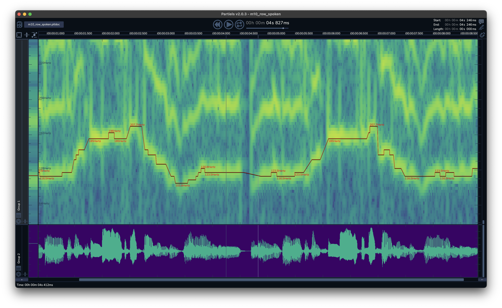

# Basic Pitch Vamp Plugin

<p align="center">
    <a href="https://github.com/Ircam-Partiels/basic-pitch-vamp-plugin/actions/workflows/ci.yml"></a>
  </p>

The Basic Pitch plugin is an implementation of the [Basic Pitch](https://github.com/spotify/basic-pitch) automatic music transcription (AMT) library, using lightweight neural network, developed by [Spotify's Audio Intelligence Lab](https://research.atspotify.com/audio-intelligence/) as a [Vamp plugin](https://www.vamp-plugins.org/).

The Basic Pitch Vamp Plugin has been designed for use in the free audio analysis application [Partiels](https://forum.ircam.fr/projects/detail/partiels/).

<p align="center">

</p>

## Installation

Download the Basic Pitch Vamp plugin installation package for your operating system from the [Releases](https://github.com/Ircam-Partiels/basic-pitch-vamp-plugin/releases) section and run the installer. 

## Use 

Launch the Partiels application. In a new or existing document, create a new analysis track with the Basic Pitch plugin. Modify the model or the analysis parameters via the property window. Please refer to the manual available in the [Releases](https://github.com/Ircam-Partiels/basic-pitch-vamp-plugin/releases) section for further information.

## Compilation

The compilation system is based on [CMake](https://cmake.org/), for example:
```
cmake . -B build -G Ninja -DCMAKE_BUILD_TYPE=Release
cmake --build build
ctest -C Debug -VV --test-dir build
```

Note: Under Linux, we recommend using Clang instead of GCC, which does not seem to support the compilation of large models.

## Credits

- **[Basic Pitch Vamp plugin](https://www.ircam.fr/)** by Pierre Guillot at IRCAM IMR Department.
- **[Basic Pitch](https://github.com/spotify/basic-pitch)** model by Spotify's Audio Intelligence Lab.
- **[TensorFlow](https://github.com/tensorflow/tensorflow)** originally developed by Google Brain team. 
- **[Vamp SDK](https://github.com/vamp-plugins/vamp-plugin-sdk)** by Chris Cannam, copyright (c) 2005-2024 Chris Cannam and Centre for Digital Music, Queen Mary, University of London.
- **[Ircam Vamp Extension](https://github.com/Ircam-Partiels/ircam-vamp-extension)** by Pierre Guillot at [IRCAM IMR department](https://www.ircam.fr/).  

## License

The Basic Pitch Vamp Plugin is distributed under the [MIT License](LICENSE). It includes third-party software and models that remain under their own licenses:

| Component | License |
| --- | --- |
| [TensorFlow Lite](https://github.com/tensorflow/tensorflow) | [Apache License 2.0](tensorflow/LICENSE) |
| [Abseil](https://github.com/abseil/abseil-cpp) (used by TensorFlow Lite) | Apache License 2.0 |
| [Eigen](https://gitlab.com/libeigen/eigen) (used by TensorFlow Lite) | Mozilla Public License 2.0 |
| [FarmHash](https://github.com/google/farmhash) (used by TensorFlow Lite) | MIT License |
| [fft2d](http://www.kurims.kyoto-u.ac.jp/~ooura/fft.html) by Takuya Ooura (used by TensorFlow Lite) | Ooura FFT license (free use, copy and modification) |
| [FlatBuffers](https://github.com/google/flatbuffers) (used by TensorFlow Lite) | Apache License 2.0 |
| [gemmlowp](https://github.com/google/gemmlowp) (used by TensorFlow Lite) | Apache License 2.0 |
| [ruy](https://github.com/google/ruy) (used by TensorFlow Lite) | Apache License 2.0 |
| [XNNPACK](https://github.com/google/XNNPACK) (used by TensorFlow Lite) | BSD 3-Clause License |
| [cpuinfo](https://github.com/pytorch/cpuinfo) (used by TensorFlow Lite) | BSD 2-Clause License |
| [pthreadpool](https://github.com/google/pthreadpool) (used by XNNPACK) | BSD 2-Clause License |
| [FP16](https://github.com/Maratyszcza/FP16) (used by XNNPACK) | MIT License |
| [FXdiv](https://github.com/Maratyszcza/FXdiv) (used by pthreadpool) | MIT License |
| [KleidiAI](https://github.com/ARM-software/kleidiai) (used by XNNPACK, 64-bit ARM only) | Apache License 2.0 |
| [ARM_NEON_2_x86_SSE](https://github.com/intel/ARM_NEON_2_x86_SSE) (used by TensorFlow Lite, x86 only) | BSD-style license |
| [Vamp Plugin SDK](https://github.com/vamp-plugins/vamp-plugin-sdk) | MIT-style license (and BSD 3-Clause for KissFFT) |
| [Ircam Vamp Extension](https://github.com/Ircam-Partiels/ircam-vamp-extension) | [MIT License](ircam-vamp-extension/LICENSE) |
| Lagrange resampler derived from [JUCE](https://github.com/juce-framework/JUCE) 7 (juce_audio_basics module) | ISC License |
| [Basic Pitch](https://github.com/spotify/basic-pitch) model (nmp.tflite) by Spotify | [Apache License 2.0](https://github.com/spotify/basic-pitch/blob/v0.4.0/LICENSE) |

The dependencies of TensorFlow Lite are downloaded by its CMake build during the configuration. The embedded model is the tflite model of [Basic Pitch v0.4.0](https://github.com/spotify/basic-pitch/tree/v0.4.0/basic_pitch/saved_models/icassp_2022), and the pre-processing, the post-processing and the note creation of the plugin are ported from the Basic Pitch Python library (Apache License 2.0). The [third-party notices](resource/ThirdPartyNotices.txt) (including the NOTICE of Basic Pitch) and the full texts of the licenses are copied into the `Resources/licenses` folder of the plugin bundle, hence they are distributed with the plugin and the installers.
